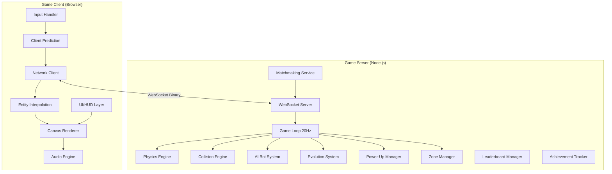
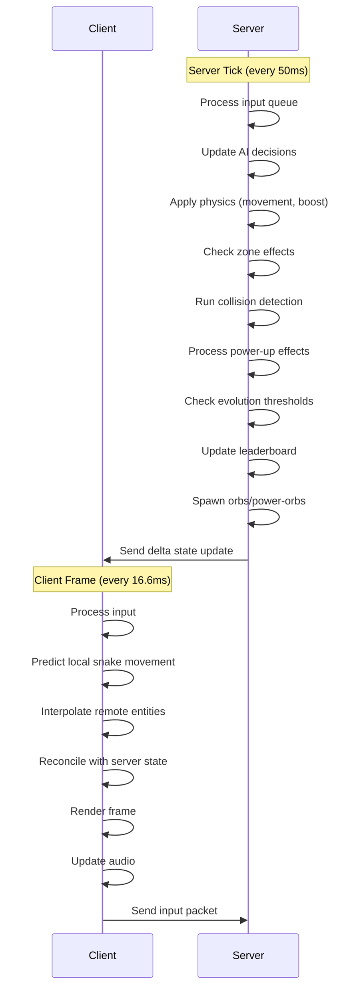
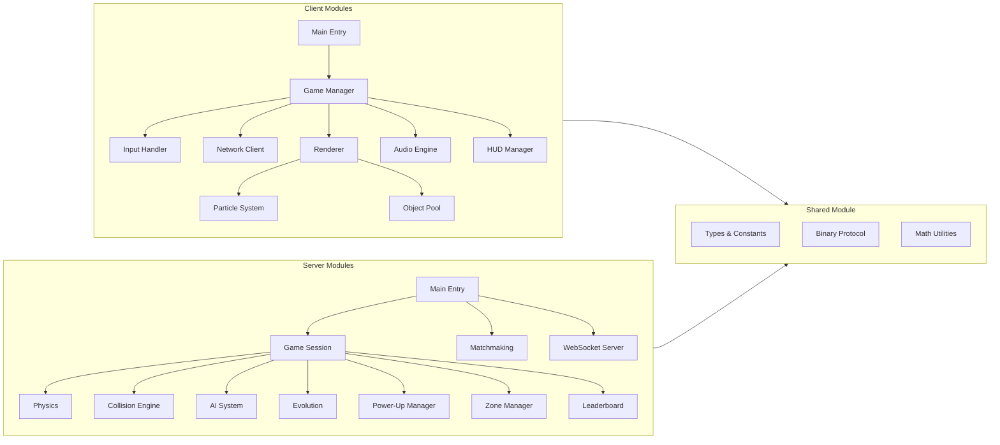

# Design Document: Slither.io Game

## Overview

This document defines the technical design for a premium-quality slither.io-style browser game featuring real-time multiplayer, an evolution system, power-ups, arena zones, multiple game modes, and AI bots. The architecture follows a client-server model with an authoritative game server, client-side prediction, and WebSocket binary communication.

The system is split into two primary applications:
- **Game Client**: A TypeScript browser app rendering on HTML5 Canvas at 60fps, handling input, prediction, interpolation, and audio/visual effects.
- **Game Server**: A Node.js TypeScript application running an authoritative simulation at 20Hz, managing physics, collision detection, matchmaking, and AI.

### Key Design Decisions

| Decision | Choice | Rationale |
|----------|--------|-----------|
| Transport | WebSocket with binary encoding | Low latency, reduced bandwidth vs JSON |
| Tick Rate | 20Hz server, 60fps client | Balance between accuracy and CPU cost |
| Collision | Spatial hash grid (100-unit cells) | O(1) average lookup for broad-phase |
| Prediction | Client-side with server reconciliation | Masks up to 150ms latency |
| Interpolation | 100ms buffer for remote entities | Smooth rendering despite network jitter |
| State sync | Delta updates per tick | Minimizes bandwidth per client |
| Object pooling | Orbs, particles, segments | Eliminates GC pauses during gameplay |

## Architecture

### High-Level System Diagram



### Game Loop Architecture



### Module Dependency Diagram



## Components and Interfaces

### Shared Module

```typescript
// shared/constants.ts
export const TICK_RATE = 20; // Hz
export const TICK_INTERVAL = 1000 / TICK_RATE; // 50ms
export const BASE_SPEED = 200; // units/sec
export const BOOST_SPEED = 350; // units/sec
export const MAX_TURN_RATE = 3; // radians/sec
export const SEGMENT_SPACING = 20; // units
export const INITIAL_SEGMENTS = 10;
export const INITIAL_MASS = 100;
export const HEAD_COLLISION_RADIUS = 15;
export const BODY_COLLISION_RADIUS = 12;
export const ORB_COLLECTION_RADIUS = 30;
export const ARENA_RADIUS = 5000; // units
export const SPATIAL_HASH_CELL_SIZE = 100;
export const MIN_ORBS = 3000;
export const ORB_SPAWN_RATE = 50; // per second
export const MAX_PLAYERS_PER_SESSION = 50;
export const INTEREST_RADIUS = 1500;
export const INTERPOLATION_BUFFER = 100; // ms
export const MAX_SPEED_CAP = 525; // units/sec

// shared/protocol.ts
export enum MessageType {
  // Client -> Server
  INPUT = 0x01,
  JOIN = 0x02,
  LEAVE = 0x03,
  BOOST_START = 0x04,
  BOOST_END = 0x05,

  // Server -> Client
  STATE_DELTA = 0x10,
  FULL_STATE = 0x11,
  SNAKE_SPAWN = 0x12,
  SNAKE_DEATH = 0x13,
  ORB_SPAWN = 0x14,
  ORB_COLLECT = 0x15,
  POWER_UP_SPAWN = 0x16,
  POWER_UP_COLLECT = 0x17,
  EVOLUTION = 0x18,
  LEADERBOARD = 0x19,
  ZONE_UPDATE = 0x1A,
  ACHIEVEMENT = 0x1B,
}

export interface InputMessage {
  seq: number;         // sequence number for reconciliation
  angle: number;       // target direction (radians)
  boosting: boolean;   // boost state
  timestamp: number;   // client timestamp
}
```

### Server Components

#### Game Session

```typescript
// server/GameSession.ts
export class GameSession {
  id: string;
  mode: GameMode;
  snakes: Map<string, Snake>;
  orbs: OrbManager;
  powerOrbs: PowerOrbManager;
  zones: ZoneManager;
  collisionEngine: CollisionEngine;
  leaderboard: LeaderboardManager;
  evolutionSystem: EvolutionSystem;
  aiManager: AIManager;
  tickNumber: number;

  constructor(mode: GameMode, config: SessionConfig);
  tick(deltaTime: number): void;
  addPlayer(playerId: string, name: string, skin: SkinConfig): Snake;
  removePlayer(playerId: string): void;
  processInput(playerId: string, input: InputMessage): void;
  getStateDelta(playerId: string): StateDelta;
  getFullState(playerId: string): FullState;
}
```

#### Collision Engine

```typescript
// server/CollisionEngine.ts
export class SpatialHashGrid {
  private cells: Map<number, Set<Entity>>;
  private cellSize: number;

  constructor(cellSize: number);
  insert(entity: Entity): void;
  remove(entity: Entity): void;
  update(entity: Entity, oldPos: Vec2, newPos: Vec2): void;
  query(position: Vec2, radius: number): Entity[];
  getCellKey(x: number, y: number): number;
  clear(): void;
}

export class CollisionEngine {
  private grid: SpatialHashGrid;

  constructor(cellSize: number);
  detectHeadToBody(snakes: Map<string, Snake>): CollisionEvent[];
  detectHeadToHead(snakes: Map<string, Snake>): CollisionEvent[];
  detectHeadToBoundary(snakes: Map<string, Snake>, arenaRadius: number): CollisionEvent[];
  detectOrbCollection(snakes: Map<string, Snake>, orbs: Orb[]): CollectionEvent[];
  detectPowerOrbCollection(snakes: Map<string, Snake>, powerOrbs: PowerOrb[]): CollectionEvent[];
  rebuildGrid(entities: Entity[]): void;
}
```

#### Physics Engine

```typescript
// server/Physics.ts
export class PhysicsEngine {
  moveSnake(snake: Snake, deltaTime: number): void;
  applyTurnRate(snake: Snake, targetAngle: number, deltaTime: number): void;
  updateSegments(snake: Snake): void;
  applyBoost(snake: Snake, deltaTime: number): void;
  applyZoneEffects(snake: Snake, zones: Zone[]): void;
  calculateEffectiveSpeed(snake: Snake): number;
  spawnDeathOrbs(snake: Snake): Orb[];
}
```

#### AI System

```typescript
// server/AIManager.ts
export enum AIState {
  FORAGING = 'foraging',
  HUNTING = 'hunting',
  EVADING = 'evading',
}

export enum AIDifficulty {
  EASY = 'easy',
  MEDIUM = 'medium',
  HARD = 'hard',
}

export class AIBot {
  id: string;
  state: AIState;
  difficulty: AIDifficulty;
  reactionTimer: number;
  targetId: string | null;
  boostCooldown: number;
  boostDuration: number;

  evaluate(snakes: Map<string, Snake>, orbs: Orb[]): InputMessage;
  transitionState(nearbySnakes: Snake[]): void;
  calculateForagingTarget(orbs: Orb[], position: Vec2): Vec2;
  calculateHuntingTarget(target: Snake): Vec2;
  calculateEvasionTarget(threats: Snake[]): Vec2;
  predictInterceptionPoint(target: Snake): Vec2;
}

export class AIManager {
  private bots: Map<string, AIBot>;
  private respawnQueue: Array<{ time: number }>;

  constructor(config: AIConfig);
  update(session: GameSession, deltaTime: number): void;
  spawnBot(session: GameSession): AIBot;
  removeBot(id: string): void;
  getPopulationTarget(): number;
}
```

#### Evolution System

```typescript
// server/EvolutionSystem.ts
export interface EvolutionStage {
  stage: number;
  name: string;
  massThreshold: number;
  devolutionThreshold: number; // 75% of massThreshold
  widthMultiplier: number;
  speedBonus: number;
  headRadiusMultiplier: number;
  boostEfficiency: number;
  orbCollectionRadius: number;
}

export class EvolutionSystem {
  private stages: EvolutionStage[];

  checkEvolution(snake: Snake): EvolutionEvent | null;
  checkDevolution(snake: Snake): EvolutionEvent | null;
  getStageForMass(mass: number): EvolutionStage;
  applyStageModifiers(snake: Snake): void;
}
```

#### Power-Up Manager

```typescript
// server/PowerUpManager.ts
export enum PowerUpType {
  SHIELD = 'shield',
  MAGNET = 'magnet',
  GHOST = 'ghost',
  SPEED_SURGE = 'speed_surge',
  MASS_DRAIN = 'mass_drain',
  FREEZE_AURA = 'freeze_aura',
}

export interface ActivePowerUp {
  type: PowerUpType;
  remainingDuration: number;
  maxDuration: number;
}

export class PowerUpManager {
  private spawnTimer: number;
  private activePowerOrbs: PowerOrb[];
  private maxPowerOrbs: number;
  private spawnInterval: number;

  update(deltaTime: number, session: GameSession): void;
  spawnPowerOrb(arena: Arena): PowerOrb | null;
  activatePowerUp(snake: Snake, type: PowerUpType): void;
  tickActivePowerUps(snakes: Map<string, Snake>, deltaTime: number): void;
  deactivatePowerUp(snake: Snake): void;
}
```

#### Zone Manager

```typescript
// server/ZoneManager.ts
export enum ZoneType {
  SPEED = 'speed',
  DANGER = 'danger',
  BONUS = 'bonus',
  STEALTH = 'stealth',
}

export interface Zone {
  id: string;
  type: ZoneType;
  center: Vec2;
  radius: number;
  active: boolean;
  fadeState: 'none' | 'fading_out' | 'fading_in';
  fadeTimer: number;
}

export class ZoneManager {
  private zones: Zone[];
  private rotationTimer: number;
  private rotationInterval: number; // 120 seconds

  constructor(arenaRadius: number);
  generateZones(count: number): void;
  update(deltaTime: number): void;
  getZonesAtPosition(position: Vec2): Zone[];
  isInsideZone(position: Vec2, zone: Zone): boolean;
  rotateZones(): void;
  validatePlacement(center: Vec2, radius: number): boolean;
}
```

### Client Components

#### Network Client

```typescript
// client/NetworkClient.ts
export class NetworkClient {
  private ws: WebSocket;
  private inputSeq: number;
  private pendingInputs: InputMessage[];
  private serverTickBuffer: ServerTick[];

  connect(url: string): Promise<void>;
  disconnect(): void;
  sendInput(input: InputMessage): void;
  onStateDelta(callback: (delta: StateDelta) => void): void;
  onEvent(type: MessageType, callback: (data: any) => void): void;
  getLatency(): number;
  reconcile(serverState: SnakeState, pendingInputs: InputMessage[]): Vec2;
}
```

#### Renderer

```typescript
// client/Renderer.ts
export class Renderer {
  private canvas: HTMLCanvasElement;
  private ctx: CanvasRenderingContext2D;
  private camera: Camera;
  private particleSystem: ParticleSystem;
  private orbPool: ObjectPool<OrbSprite>;
  private segmentPool: ObjectPool<SegmentSprite>;

  constructor(canvas: HTMLCanvasElement);
  render(gameState: ClientGameState): void;
  renderBackground(camera: Camera): void;
  renderZones(zones: Zone[], camera: Camera): void;
  renderOrbs(orbs: Orb[], camera: Camera): void;
  renderSnakes(snakes: Snake[], camera: Camera, localPlayerId: string): void;
  renderParticles(deltaTime: number): void;
  renderHUD(playerState: PlayerState): void;
  renderMiniMap(state: MiniMapState): void;
  updateCamera(target: Vec2, mass: number): void;
  isInViewport(position: Vec2, radius: number): boolean;
}
```

#### Particle System

```typescript
// client/ParticleSystem.ts
export interface Particle {
  position: Vec2;
  velocity: Vec2;
  life: number;
  maxLife: number;
  size: number;
  color: Color;
  alpha: number;
}

export class ParticleSystem {
  private particles: ObjectPool<Particle>;
  private emitters: ParticleEmitter[];

  emit(config: EmitterConfig): void;
  update(deltaTime: number): void;
  render(ctx: CanvasRenderingContext2D, camera: Camera): void;
  spawnDeathExplosion(position: Vec2, segmentCount: number): void;
  spawnCollectionEffect(position: Vec2, color: Color): void;
  spawnBoostTrail(position: Vec2, direction: number): void;
  spawnEvolutionEffect(position: Vec2, stage: number): void;
  setDensityMultiplier(multiplier: number): void;
}
```

#### Input Handler

```typescript
// client/InputHandler.ts
export class InputHandler {
  private isMobile: boolean;
  private canvas: HTMLCanvasElement;
  private targetAngle: number;
  private isBoosting: boolean;

  constructor(canvas: HTMLCanvasElement);
  getInput(): InputMessage;
  onDirectionChange(callback: (angle: number) => void): void;
  onBoostChange(callback: (active: boolean) => void): void;
  setupDesktopControls(): void;
  setupMobileControls(): void;
  detectDeviceType(): boolean;
  getTargetAngle(): number;
  isMobileDevice(): boolean;
}
```

#### Audio Engine

```typescript
// client/AudioEngine.ts
export class AudioEngine {
  private audioContext: AudioContext;
  private musicVolume: number;
  private sfxVolume: number;
  private muted: boolean;
  private baseLayer: AudioBufferSourceNode | null;
  private intensityLayer: GainNode | null;

  constructor();
  initialize(): Promise<void>;
  playOrbCollect(orbValue: number): void;
  playBoostStart(): void;
  playBoostStop(): void;
  playExplosion(distance: number): void;
  playEvolution(): void;
  playPowerUpCollect(type: PowerUpType): void;
  updateIntensityLayer(nearestSnakeDistance: number): void;
  setMusicVolume(volume: number): void;
  setSfxVolume(volume: number): void;
  setMuted(muted: boolean): void;
  handleVisibilityChange(visible: boolean): void;
  loadSettings(): void;
  saveSettings(): void;
}
```

## Data Models

### Core Entities

```typescript
// shared/types.ts
export interface Vec2 {
  x: number;
  y: number;
}

export interface Color {
  r: number;
  g: number;
  b: number;
  a: number;
}

export interface Snake {
  id: string;
  name: string;
  head: Vec2;
  direction: number;           // current heading in radians
  targetDirection: number;     // desired heading
  segments: Vec2[];            // body segment positions
  mass: number;
  speed: number;              // effective speed after modifiers
  isBoosting: boolean;
  isAlive: boolean;
  evolutionStage: number;
  activePowerUp: ActivePowerUp | null;
  skin: SkinConfig;
  team: number | null;        // team ID for Team mode
  pathHistory: Vec2[];        // recorded positions for segments to follow
  massAccumulator: number;    // cumulative mass toward next segment
  boostLocked: boolean;       // true when mass < 10 during boost
  isBot: boolean;
}

export interface Orb {
  id: number;
  position: Vec2;
  size: number;              // 1-5
  value: number;             // equals size
  color: number;             // palette index 0-11
}

export interface PowerOrb {
  id: number;
  position: Vec2;
  type: PowerUpType;
}

export interface Zone {
  id: string;
  type: ZoneType;
  center: Vec2;
  radius: number;
  active: boolean;
  fadeState: 'none' | 'fading_out' | 'fading_in';
}

export interface SkinConfig {
  primaryColor: Color;
  secondaryColor: Color;
  pattern: 'solid' | 'striped' | 'gradient' | 'dotted' | 'zigzag';
  headShape: 'round' | 'arrow' | 'diamond' | 'star' | 'skull' | 'crown' | 'flame' | 'crystal';
  trailEffect: 'none' | 'sparkles' | 'flames' | 'bubbles' | 'lightning' | 'rainbow';
}
```

### Game State Models

```typescript
export enum GameMode {
  CLASSIC = 'classic',
  BATTLE_ROYALE = 'battle_royale',
  TEAM = 'team',
  INFINITE_GROWTH = 'infinite_growth',
}

export interface GameSessionState {
  id: string;
  mode: GameMode;
  tickNumber: number;
  arenaRadius: number;       // shrinks in Battle Royale
  snakes: Map<string, Snake>;
  orbs: Orb[];
  powerOrbs: PowerOrb[];
  zones: Zone[];
  leaderboard: LeaderboardEntry[];
  elapsedTime: number;
}

export interface LeaderboardEntry {
  playerId: string;
  name: string;
  mass: number;
  evolutionStage: number;
  rank: number;
  timestamp: number;         // when this mass was first reached (for tie-breaking)
}

export interface StateDelta {
  tick: number;
  snakeUpdates: SnakeUpdate[];
  orbSpawns: Orb[];
  orbRemovals: number[];
  powerOrbSpawns: PowerOrb[];
  powerOrbRemovals: number[];
  events: GameEvent[];
  zoneUpdates: ZoneUpdate[];
  leaderboard: LeaderboardEntry[];
}

export interface SnakeUpdate {
  id: string;
  head: Vec2;
  direction: number;
  mass: number;
  speed: number;
  isBoosting: boolean;
  evolutionStage: number;
  activePowerUp: PowerUpType | null;
  segmentCount: number;
  // Only send full segments on spawn or significant change
  segments?: Vec2[];
}
```

### Binary Protocol Format

```typescript
// shared/BinaryProtocol.ts
/**
 * Input Message (Client -> Server): 13 bytes
 * [type: u8][seq: u16][angle: f32][boosting: u8][timestamp: u32]
 *
 * State Delta Header (Server -> Client): variable
 * [type: u8][tick: u32][snakeCount: u16][orbSpawnCount: u16][orbRemoveCount: u16][eventCount: u8]
 *
 * Snake Update: 29 bytes
 * [id: u16][headX: f32][headY: f32][direction: f32][mass: u16][speed: u16][flags: u8][stage: u8][segCount: u16]
 *
 * Orb Spawn: 13 bytes
 * [id: u16][x: f32][y: f32][size: u8]
 *
 * Orb Remove: 2 bytes
 * [id: u16]
 */
export class BinaryProtocol {
  static encodeInput(msg: InputMessage): ArrayBuffer;
  static decodeInput(buffer: ArrayBuffer): InputMessage;
  static encodeStateDelta(delta: StateDelta): ArrayBuffer;
  static decodeStateDelta(buffer: ArrayBuffer): StateDelta;
  static encodeFullState(state: FullState): ArrayBuffer;
  static decodeFullState(buffer: ArrayBuffer): FullState;
}
```

### Achievement Data Model

```typescript
export interface Achievement {
  id: string;
  category: 'growth' | 'combat' | 'survival' | 'collection' | 'mastery';
  name: string;
  description: string;
  targetValue: number;
  currentValue: number;
  completed: boolean;
  reward: CosmeticReward;
}

export interface CosmeticReward {
  type: 'skin' | 'trail' | 'color' | 'head_shape';
  id: string;
  name: string;
}

export interface DailyChallenge {
  id: string;
  date: string;              // ISO date
  objective: string;
  targetValue: number;
  currentValue: number;
  completed: boolean;
  reward: CosmeticReward;
}
```

### Configuration Models

```typescript
export interface SessionConfig {
  mode: GameMode;
  maxPlayers: number;
  arenaRadius: number;
  minOrbs: number;
  orbSpawnRate: number;
  powerOrbSpawnInterval: number;
  maxPowerOrbs: number;
  zoneCount: number;
  zoneRotationInterval: number;
  aiEnabled: boolean;
  aiCount: { min: number; max: number };
}

export interface EvolutionConfig {
  stages: EvolutionStage[];
}

export const EVOLUTION_STAGES: EvolutionStage[] = [
  { stage: 1, name: 'Hatchling', massThreshold: 0, devolutionThreshold: 0, widthMultiplier: 1.0, speedBonus: 0, headRadiusMultiplier: 1.0, boostEfficiency: 1.0, orbCollectionRadius: 30 },
  { stage: 2, name: 'Serpent', massThreshold: 100, devolutionThreshold: 75, widthMultiplier: 1.3, speedBonus: 0.05, headRadiusMultiplier: 1.0, boostEfficiency: 1.0, orbCollectionRadius: 30 },
  { stage: 3, name: 'Wyrm', massThreshold: 500, devolutionThreshold: 375, widthMultiplier: 1.3, speedBonus: 0.05, headRadiusMultiplier: 0.9, boostEfficiency: 1.0, orbCollectionRadius: 30 },
  { stage: 4, name: 'Dragon', massThreshold: 1500, devolutionThreshold: 1125, widthMultiplier: 1.3, speedBonus: 0.05, headRadiusMultiplier: 0.9, boostEfficiency: 0.85, orbCollectionRadius: 30 },
  { stage: 5, name: 'Leviathan', massThreshold: 5000, devolutionThreshold: 3750, widthMultiplier: 1.3, speedBonus: 0.05, headRadiusMultiplier: 0.9, boostEfficiency: 0.85, orbCollectionRadius: 50 },
];
```


## Correctness Properties

*A property is a characteristic or behavior that should hold true across all valid executions of a system—essentially, a formal statement about what the system should do. Properties serve as the bridge between human-readable specifications and machine-verifiable correctness guarantees.*

### Property 1: Segment Spacing Invariant

*For any* Snake with N segments, after any movement update (regardless of direction changes, speed, or boost state), the Euclidean distance between every pair of consecutive segment centers SHALL be exactly 20 units (within floating-point tolerance of 0.001).

**Validates: Requirements 1.1, 1.5**

### Property 2: Turn Rate Bound

*For any* Snake with current direction D, target direction T, and delta time dt, the angular change applied to the Snake's heading SHALL NOT exceed 3 * dt radians, and the resulting direction SHALL be closer to (or equal to) the target direction than the original.

**Validates: Requirements 1.3**

### Property 3: Position Interpolation Correctness

*For any* two valid Snake states S1 and S2 and interpolation factor t in [0, 1], the interpolated position SHALL lie on the line segment between S1.position and S2.position, with interpolated position at t=0 equaling S1.position and at t=1 equaling S2.position.

**Validates: Requirements 1.6, 17.4**

### Property 4: Spawn Position Validity

*For any* arena state with existing Snakes, a newly spawned Snake's position SHALL be within the inner 70% of the Arena radius (or 85% if inner 70% has no valid positions), and SHALL be at least 300 units from every existing Snake head.

**Validates: Requirements 1.7, 1.8**

### Property 5: Orb Collection Distance Threshold

*For any* Snake head position H and Orb position O, a collection event SHALL occur if and only if the Euclidean distance between H and O is less than 30 units, and the first Snake detected within range in a tick SHALL be the sole collector.

**Validates: Requirements 2.3**

### Property 6: Segment Growth from Mass Accumulation

*For any* Snake that collects a sequence of Orbs totaling M mass points, the number of new segments added SHALL equal floor(M / 10), with the accumulator carrying over the remainder.

**Validates: Requirements 2.5**

### Property 7: Head-to-Body Collision Detection

*For any* Snake A head position and Snake B body segment position, a collision SHALL be detected if and only if the distance between them is less than 27 units (15 + 12), AND Snake A and Snake B are different Snakes.

**Validates: Requirements 3.1, 3.8**

### Property 8: Death Orb Mass Conservation

*For any* eliminated Snake with mass M, the sum of all generated death orbs' values SHALL equal floor(0.8 * M), and exactly one orb SHALL be placed at each body segment position.

**Validates: Requirements 3.2, 3.3**

### Property 9: Arena Boundary Elimination

*For any* Snake head position H and arena radius R, the Snake SHALL be eliminated if and only if the distance from H to the arena center exceeds (R - 15).

**Validates: Requirements 3.4, 8.4**

### Property 10: Head-to-Head Mutual Elimination

*For any* two Snake heads H1 and H2, both Snakes SHALL be eliminated if and only if the distance between H1 and H2 is less than 30 units.

**Validates: Requirements 3.5**

### Property 11: Spatial Hash Grid Query Correctness

*For any* set of entities inserted into the spatial hash grid and any query position P with radius R, the query result SHALL contain exactly those entities whose position is within R units of P (no false negatives), and SHALL NOT contain any entity beyond R units of P (no false positives).

**Validates: Requirements 3.6**

### Property 12: Effective Speed Calculation

*For any* Snake with evolution stage S, boost state B, zone effects Z, and power-up effects P, the effective speed SHALL be calculated as: baseSpeed × stageBonus × zoneMultiplier + boostBonus, capped at MAX_SPEED_CAP (525 units/sec). Boost speed SHALL be exactly 350 regardless of zone multipliers or Speed_Surge. Speed_Surge SHALL set base to 300 and prevent boost activation.

**Validates: Requirements 4.1, 4.7, 6.8, 7.3**

### Property 13: Boost Mass Drain Invariant

*For any* Snake in boost state for duration dt seconds, the mass lost SHALL equal 14 × dt × boostEfficiency (where boostEfficiency is 0.85 for Stage 4+, 1.0 otherwise), and the number of trail orbs spawned SHALL equal floor(dt / 0.1).

**Validates: Requirements 4.2, 4.3, 6.3**

### Property 14: Boost Lockout Hysteresis

*For any* Snake, boost SHALL be deactivated and locked when mass falls below 10, and SHALL remain locked until mass exceeds 15, regardless of input state changes in between.

**Validates: Requirements 4.4**

### Property 15: Power-Up State Machine

*For any* Snake with active power-up of type T1 and remaining duration D1: collecting the same type T1 SHALL reset duration to max without stacking effects; collecting a different type T2 SHALL immediately replace T1 with T2 at full duration; expiry (duration reaching 0) SHALL revert the Snake to its normal unmodified state within the same tick.

**Validates: Requirements 5.11, 5.12, 5.13**

### Property 16: Shield Collision Absorption

*For any* Snake with an active Shield power-up, the first head-to-body collision event SHALL be absorbed (Snake survives and shield is consumed), and any subsequent collision SHALL eliminate the Snake normally. Arena boundary collisions SHALL NOT be absorbed by shield.

**Validates: Requirements 5.3**

### Property 17: Ghost Phase-Through

*For any* Snake with an active Ghost power-up, all head-to-body and body-to-head collision checks involving that Snake SHALL return no collision for the power-up's duration.

**Validates: Requirements 5.5**

### Property 18: Freeze Aura Range Effect

*For any* Snake with an active Freeze_Aura power-up, all other Snakes within 200 units SHALL have their effective speed reduced to 50% of their calculated speed, and Snakes beyond 200 units SHALL be unaffected.

**Validates: Requirements 5.8**

### Property 19: Evolution Stage Assignment

*For any* Snake with mass M, the evolution stage SHALL be the highest stage whose massThreshold is ≤ M. Devolution SHALL occur when M falls below 75% of the current stage's threshold, evaluated recursively so multiple stage losses can occur in one tick.

**Validates: Requirements 6.1, 6.2, 6.3, 6.4, 6.6**

### Property 20: Zone Placement Constraints

*For any* generated set of Zones, all zones SHALL satisfy: no two zone boundaries overlap, every zone center is at least 600 units from the Arena_Boundary, at least one zone of each type exists, and count is between 5 and 8 inclusive.

**Validates: Requirements 7.1, 7.2**

### Property 21: Zone Effect Application and Removal

*For any* Snake position and set of active zones, zone effects SHALL be applied if and only if the snake is geometrically inside the zone circle AND the zone's fadeState is 'none'. Effects SHALL be removed immediately when a zone begins fading out.

**Validates: Requirements 7.3, 7.4, 7.6, 7.9**

### Property 22: Battle Royale Arena Shrink

*For any* elapsed time T in Battle Royale mode, the arena radius SHALL equal originalRadius × (1 - 0.05 × floor(T / 30)), and no Snake outside the current boundary SHALL survive.

**Validates: Requirements 8.3, 8.4**

### Property 23: Team Division Logic

*For any* player count N in Team mode: 2-8 players → 2 teams, 9-18 players → 3 teams, 19-48 players → 4 teams. Team members SHALL NOT collide with each other.

**Validates: Requirements 8.6**

### Property 24: AI State Transition Correctness

*For any* AI bot with mass M_bot and nearby snakes, the bot SHALL transition to Hunting when a snake with mass < 0.6 × M_bot is within detection range, to Evading when a snake with mass > 1.5 × M_bot is within 300 units, and back to Foraging when no valid target/threat remains within the extended range (500 units for hunt targets, 400 units for threats).

**Validates: Requirements 9.2, 9.3, 9.4, 9.5, 9.6**

### Property 25: AI Boost Discipline

*For any* AI bot in Hunting state, boost activation SHALL last no more than 2 seconds per burst, with a minimum 3-second cooldown between bursts.

**Validates: Requirements 9.7**

### Property 26: Leaderboard Ordering

*For any* set of players with masses and timestamps, the leaderboard SHALL be sorted by mass descending, with ties broken by earliest timestamp (ascending), and SHALL contain exactly the top 10 entries (or all entries if fewer than 10 players).

**Validates: Requirements 10.1**

### Property 27: Binary Protocol Round-Trip

*For any* valid InputMessage, encoding then decoding SHALL produce an identical message. *For any* valid StateDelta, encoding then decoding SHALL produce an equivalent StateDelta (within floating-point tolerance for numeric fields).

**Validates: Requirements 17.1**

### Property 28: Client Prediction Reconciliation

*For any* server authoritative state S and sequence of pending (unacknowledged) client inputs I[], replaying the inputs on top of the server state SHALL produce a deterministic predicted position, and the correction from predicted to actual SHALL be applied smoothly over 200ms.

**Validates: Requirements 17.3**

### Property 29: Interest Management Filtering

*For any* player viewport center V and set of entities E, the state delta sent to that player SHALL contain exactly those entities within 1500 units of V (no entities beyond 1500 units, no missing entities within 1500 units).

**Validates: Requirements 17.8, 21.4**

### Property 30: Viewport Culling Correctness

*For any* camera position, zoom level, and set of entities, the renderer SHALL draw exactly those entities whose bounding circle intersects the visible viewport plus a 200-unit buffer.

**Validates: Requirements 21.2**

### Property 31: Orb Density Distribution

*For any* large sample of spawned orb positions, the density of orbs within 30% of the center radius SHALL be approximately 2× the density in the outer regions.

**Validates: Requirements 2.7**

### Property 32: Matchmaking Lowest Ping Assignment

*For any* set of available game sessions with open slots and varying pings, a joining player SHALL be assigned to the session with the lowest ping.

**Validates: Requirements 17.7**

## Error Handling

### Network Errors

| Error Condition | Response | Recovery |
|----------------|----------|----------|
| WebSocket disconnect | Show reconnection indicator | Attempt 3 reconnections over 5 seconds |
| Reconnection failure | Display connection-lost message | Return to Lobby |
| Latency > 300ms for 5s | Server disconnects player | Client shows timeout notification |
| Session full (50 players) | Reject join request | Assign to next available session |
| No sessions available | Create new session | Fill with AI bots while waiting |

### Game State Errors

| Error Condition | Response | Recovery |
|----------------|----------|----------|
| Invalid spawn position (70%) | Expand search to 85% | If still no position, queue spawn for next tick |
| Mass below 10 during boost | Lock boost immediately | Unlock when mass > 15 |
| Mass below 10 in Danger Zone | Eliminate snake | Generate death orbs |
| Power-up on already-active same type | Reset duration | No stacking |
| Frame rate < 50fps for 1s | Reduce particle density 50% | Restore at 55fps for 2s |
| Frame rate < 30fps for 2s | Disable particles, reduce animations | Restore at 45fps |
| Frame rate < 30fps for 5s after reduction | Halve draw distance, disable HUD animations | Restore at 45fps |

### Storage Errors

| Error Condition | Response | Recovery |
|----------------|----------|----------|
| Local storage unavailable | Show warning message | Track in-session memory only |
| Local storage full | Show warning message | Continue without persistence |

### Audio Errors

| Error Condition | Response | Recovery |
|----------------|----------|----------|
| Audio context suspended (autoplay) | Display unmute prompt | Initialize on first user interaction |
| Tab loses focus | Reduce all audio to 0% | Restore on tab regain focus |

## Testing Strategy

### Unit Tests (Example-Based)

Unit tests cover specific scenarios, edge cases, and integration points:

- **Input Handling**: Direction calculation from cursor positions, mobile touch handling, boost button detection
- **UI/HUD**: Leaderboard display format, death screen content, achievement notifications, mini-map position calculations
- **Audio**: Volume state management, mute toggle, crossfade triggers
- **Rendering**: Camera zoom calculation, particle system configuration, animation timing
- **Game Modes**: Configuration validation for each mode, Battle Royale timer logic
- **Matchmaking**: Session creation, capacity enforcement, reconnection state machine
- **Achievements**: Progress tracking, completion detection, reward assignment
- **Daily Challenges**: Date rotation, progress persistence, duplicate prevention

### Property-Based Tests

Property-based tests verify universal invariants across generated inputs. Each property test runs a minimum of 100 iterations.

**Library**: [fast-check](https://github.com/dubzzz/fast-check) (TypeScript PBT library)

**Configuration**:
- Minimum 100 iterations per property
- Each test tagged with: `// Feature: slither-io-game, Property {N}: {title}`

**Property Test Coverage**:

| Property | Focus Area | Generator Strategy |
|----------|-----------|-------------------|
| 1: Segment Spacing | Physics | Random direction sequences, speeds |
| 2: Turn Rate Bound | Physics | Random angles, delta times |
| 3: Interpolation | Networking | Random state pairs, t values |
| 4: Spawn Validity | Spawning | Random existing snake placements |
| 5: Orb Collection | Collision | Random positions, distances |
| 6: Segment Growth | Growth | Random mass gain sequences |
| 7: Head-to-Body | Collision | Random snake geometries |
| 8: Death Orb Conservation | Death | Random snake masses, lengths |
| 9: Boundary Elimination | Collision | Random positions near boundary |
| 10: Head-to-Head | Collision | Random head position pairs |
| 11: Spatial Hash | Data Structure | Random entity sets, queries |
| 12: Speed Calculation | Physics | Random modifier combinations |
| 13: Boost Drain | Mechanics | Random durations, stages |
| 14: Boost Lockout | State Machine | Random mass sequences |
| 15: Power-Up State | State Machine | Random collection sequences |
| 16: Shield Absorption | Power-Ups | Random collision sequences |
| 17: Ghost Phase | Power-Ups | Random collision events |
| 18: Freeze Range | Power-Ups | Random positions, distances |
| 19: Evolution Stage | Progression | Random mass values |
| 20: Zone Placement | Map Gen | Random arena configurations |
| 21: Zone Effects | Zones | Random positions, zone states |
| 22: BR Shrink | Game Mode | Random elapsed times |
| 23: Team Division | Game Mode | Random player counts |
| 24: AI Transitions | AI | Random mass ratios, distances |
| 25: AI Boost | AI | Random hunting sequences |
| 26: Leaderboard | Scoring | Random mass/timestamp sets |
| 27: Protocol Round-Trip | Networking | Random messages |
| 28: Prediction | Networking | Random states, input queues |
| 29: Interest Management | Networking | Random entity positions |
| 30: Viewport Culling | Rendering | Random entity/camera positions |
| 31: Orb Density | Spawning | Large sample statistical test |
| 32: Matchmaking | Networking | Random session pings |

### Integration Tests

- **End-to-end multiplayer**: Two clients connect, move, collect orbs, verify state sync
- **WebSocket binary protocol**: Full message round-trip over real WebSocket
- **Performance benchmark**: 50 snakes + 5000 orbs tick completes within 30ms
- **Asset loading**: All assets load within 10 seconds on throttled connection
- **Session lifecycle**: Join, play, die, spectate, rejoin flow

### Test Organization

```
tests/
├── unit/
│   ├── physics.test.ts
│   ├── collision.test.ts
│   ├── evolution.test.ts
│   ├── powerups.test.ts
│   ├── zones.test.ts
│   ├── ai.test.ts
│   ├── leaderboard.test.ts
│   ├── matchmaking.test.ts
│   └── audio.test.ts
├── property/
│   ├── segment-spacing.property.ts
│   ├── collision-detection.property.ts
│   ├── speed-calculation.property.ts
│   ├── evolution-stages.property.ts
│   ├── powerup-state.property.ts
│   ├── zone-effects.property.ts
│   ├── ai-behavior.property.ts
│   ├── leaderboard-ordering.property.ts
│   ├── binary-protocol.property.ts
│   ├── spatial-hash.property.ts
│   ├── interest-management.property.ts
│   └── game-modes.property.ts
├── integration/
│   ├── multiplayer.test.ts
│   ├── websocket.test.ts
│   ├── performance.test.ts
│   └── session-lifecycle.test.ts
└── setup.ts
```
